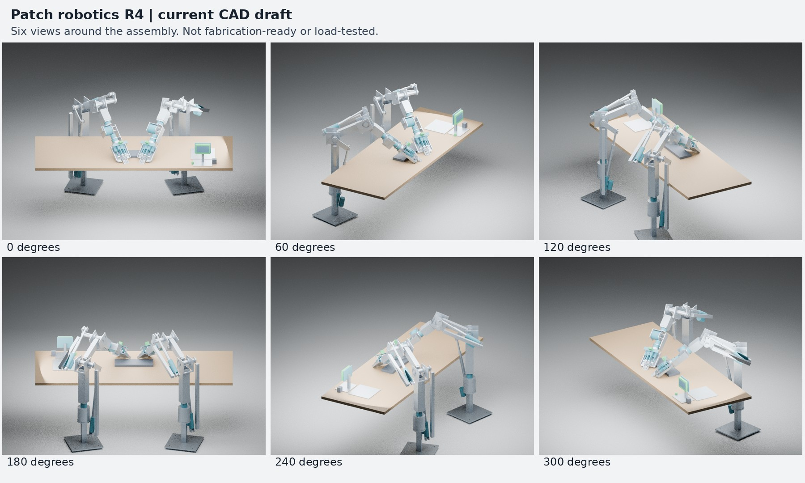

# Dot’s Arms

**Designed by dot to Christopher Kalkowski’s specifications.**

Robot arms, tendon-driven hands and a workbench concept, developed through Christopher’s requirements and iterative direction with his AI assistant, Patch (dot, powered by OpenAI). These are digital design studies, not a tested physical robot or an OpenAI-certified product.

> **DO NOT PHYSICALLY BUILD THIS WITHOUT CONTACTING CHRISTOPHER FIRST.** Obtain his prior written permission and arrange an opportunity for him to watch the build. [Contact Christopher](https://chriskalkowski.com/contact/). Permission is not engineering or safety approval.

> **WORK IN PROGRESS. NOT FABRICATION-READY. NO VERIFIED PAYLOAD RATING.** Do not energize or rely on these files as released engineering drawings.

## What you can explore

- Two detachable, floor-supported robot arm candidates
- Tendon-driven paired hand candidates and a separate alternative capture tool
- Screen-head, keyboard, wrist-camera carriers and cooled printer-part workbench references
- Individually named FreeCAD geometry and STEP exchange models
- Actual CAD renders and part-by-part explanations

## Published snapshot

The first package is the **historical R4 full-workstation review snapshot, dated 2026-10-02**. It contains 394 named assembly objects. It is the source of the complete desk-and-arms exhibit, not a claim that R4 is the latest engineering revision. Later partial-arm reviews exist; they must not be silently mixed with the full R4 assembly.

[Download the R4 review package](Dots_Arms_R4_Review_Only.zip).

Open the review ZIP, read `README_FIRST.txt`, then open `CAD/Patch_R4_WIP_Full_Assembly.FCStd` in FreeCAD. STEP copies are supplied for other CAD viewers. The capture tool is an alternative end effector, not something to mount on top of a hand.

## Christopher’s design targets

The target is 30 lb (13.608 kg) per arm/hand at a three-foot (914.4 mm) reach, with typical proposed tasks around 5–10 lb. **These are requirements, not achieved ratings.** Intended studies include cooled 3D-printer part handling, tabletop assembly, keyboard interaction and interchangeable tools. No combined 60 lb lift rating is established.

## What remains unfinished

Exact hardware selection and mounting; complete swept and cross-arm collision checking; revised structural loads, stresses and masses; tendon routing, wear and terminations; electrical and independent safety systems; power-loss load retention; heat/duty-cycle evaluation; and physical fit, endurance and commissioning. Screens, cameras and an AI planner are not substitutes for independent safety hardware.

CAD solid-validity checks and a few sampled poses do not establish a safe mechanism or usable complete workspace. Some geometry represents component envelopes. The shoulder-drive candidate is slow and duty-cycle-limited; there is no performance guarantee or purchase-ready bill of materials.

## License and contribution

Source-available for digital study, teaching and internal business use under the included [LICENSE](LICENSE), with restrictions on resale and paid access and an additional physical-build permission requirement. **This is not an OSI open-source license.** Third-party material is not relicensed by this project.

You can share links, review the design and propose digital improvements under those terms. Contact Christopher before any physical build. Do not upload credentials, private recordings or unlicensed third-party assets in issues or pull requests.

## Integrity

`SHA256SUMS.txt` lists SHA-256 checksums for the exact published review files. Checksums verify file identity; they do not establish design safety.

Two historical FreeCAD Python generators for the hands and alternative capture tool are supplied. They do not operate hardware. See the ZIP’s Source/README.txt for dependencies and output paths. The full-workstation matching generator is unavailable; the older arm generator is excluded to avoid a false reproducibility claim.
